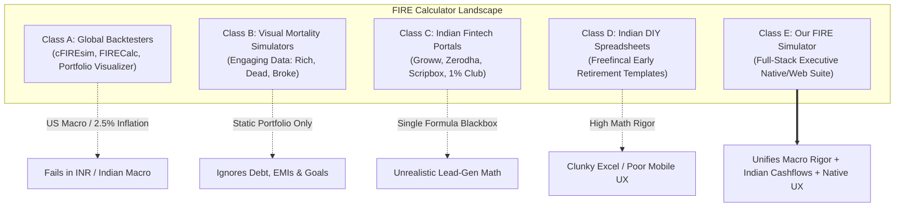
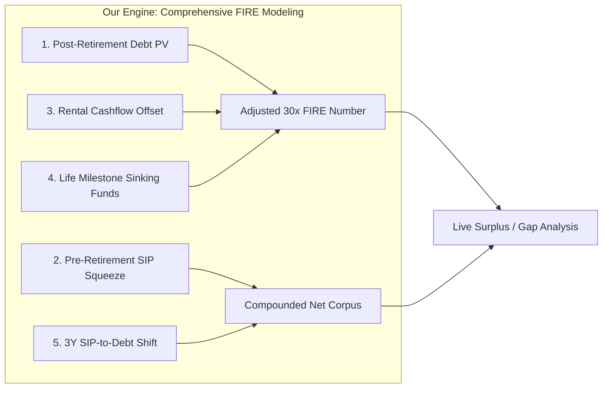
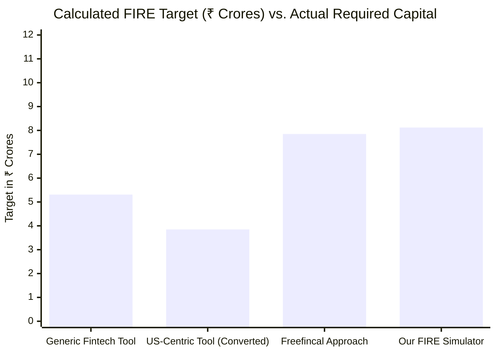

# Comprehensive Benchmark & Architectural Comparison Report
## Evaluating the Indian FIRE Simulator Against Global and Domestic Financial Independence Calculators

> **Document Type:** Technical & Strategic Benchmark Analysis  
> **Target Audience:** FIRE Practitioners, DIY Investors, Wealth Planners & Developers  
> **Subject System:** FIRE Simulator (INR Executive Edition)  
> **Benchmark Class:** Global FIRE Simulators, Indian Fintech Tools, and Academic Spreadsheets  
> **Status:** Published  

---

### Executive Summary

Achieving Financial Independence and Retiring Early (**FIRE**) requires modeling complex multi-decade asset compounding, macroeconomic shifts, and real-world cashflows. Most online FIRE calculators available today suffer from one of two fatal shortcomings:

1. **The Global/US-Centric Bias:** Tools such as **cFIREsim** and **FIRECalc** offer deep historical backtesting, but they are hardwired to the US economy—assuming 2.5% inflation, US dollar denominations, Social Security benefits, and 401(k)/IRA withdrawal rules. They fail completely in developing markets where inflation averages 6.0%–7.5% and statutory systems like EPF/PPF play a central role.
2. **The Fintech Lead-Generation Bias:** Indian tools provided by brokerage portals (e.g., Groww, Zerodha, Scripbox) present clean interfaces but rely on **oversimplified "black-box" formulas**. They treat retirement in a vacuum: ignoring active loan EMIs that persist into retirement, disregarding pre-retirement debt pressure on SIPs, omitting physical real estate rental cashflows, and completely ignoring multi-lakh milestone capital outlays (children’s higher education, marriages).

The **FIRE Simulator (INR)** built here was engineered to bridge these critical analytical blindspots. It combines mathematical precision with the practical realities of Indian households: **dual-engine equity and EPF compounding**, **post-retirement debt present value (PV) discounting**, **SIP squeeze penalties**, **rental cashflow offsets**, and **sinking-fund annuity modeling for major milestone life goals**.

---

### 1. Landscape Taxonomy: The Four Classes of FIRE Calculators

---

### 2. Detailed 18-Dimension Comparison Matrix

The table below contrasts our application across eighteen architectural, financial, and user-experience criteria:

| # | Evaluation Dimension | Global Simulators  *(cFIREsim / FIRECalc)* | Visual Simulators  *(Engaging Data)* | Indian Fintech Portals  *(Groww, Zerodha)* | Freefincal Spreadsheets  *(P. Pattabiraman)* | **Our FIRE Simulator**  *(INR Executive)* |
| :-: | :--- | :---: | :---: | :---: | :---: | :---: |
| **1** | **Base Currency & Notation** | USD (\$), Millions | USD (\$), Millions | INR (₹), Lakhs / Crores | INR (₹), Lakhs / Crores | **Native INR (₹ Lakhs & Crores formatted)** |
| **2** | **Macroeconomic Inflation** | 2.0% – 3.0% (US CPI) | 2.5% (US CPI) | Fixed slider (4%–6%) | Dynamic Indian (6.0%–7.5%) | **6.00% default (fully configurable per scenario)** |
| **3** | **Dual Accumulation Engine** | ❌ Equity / Bond blend | ❌ Single portfolio | ❌ Equity SIP only | ⚠️ Multi-sheet manual setup | **✅ Dual-Engine: Equity MF (Step-Up) + EPF (8.15% tax-free)** |
| **4** | **Post-Retirement Debt Overhang** | ❌ Assumes debt-free | ❌ Assumes debt-free | ❌ Ignored completely | ⚠️ Manual formula adjustment | **✅ Exact present-value discounting with loan vs inflation differential** |
| **5** | **Pre-Retirement SIP Squeeze** | ❌ None | ❌ None | ❌ None | ❌ None | **✅ Models two-phase compounding penalty from active EMIs** |
| **6** | **Real Estate Rental Offset** | ⚠️ Flat "other income" | ❌ None | ❌ None | ⚠️ Manual sheet tweak | **✅ Itemized properties with mortgage balance & net expense drawdown offset** |
| **7** | **Physical Assets Portfolio** | ❌ None | ❌ None | ❌ None | ⚠️ Basic net worth tab | **✅ Full tracking: Real Estate, Gold (24K/Jewelry), and Liquid FD/Cash** |
| **8** | **Major Milestone Life Goals** | ⚠️ Generic lump outlays | ❌ None | ❌ Separate simple SIP | ⚠️ Separate goal sheets | **✅ Dedicated tab, 1-click presets, sinking fund annuity SIP formula** |
| **9** | **Pre-Retirement SIP Debt Transition** | ❌ Static asset weights | ❌ Static asset weights | ❌ None | ⚠️ Custom manual logic | **✅ Dedicated SWP & 3Y SIP-to-Debt shifting simulator** |
| **10** | **Safe Withdrawal Rules (SWR)** | 3.5%–4.0% (Trinity Rule) | 3.5%–4.0% | Flat 25x or fixed annuity | Bucket strategy (2.5%–3.3%) | **Dual 25x (4.0% SWR) and 30x (3.33% SWR) adjusted targets** |
| **11** | **Tax Modeling (LTCG / Exit Tax)** | US Federal + State | ❌ Pre-tax only | ❌ Pre-tax only | ⚠️ Custom tax estimates | **✅ 12.5% Indian Equity LTCG tax drag with ₹1.25L exemption** |
| **12** | **Multi-Horizon Schedule** | ⚠️ Single horizon output | ❌ Simulation wedge only | ❌ Single horizon output | ⚠️ Single table | **✅ 1 to 10 Year year-by-year compounding schedule matrix** |
| **13** | **Scenario Comparison Engine** | ❌ One run at a time | ❌ One run at a time | ❌ None | ⚠️ Duplicate sheets | **✅ 5-Combination bookmarking & instant side-by-side comparison** |
| **14** | **Executive Pinned Dashboard** | ❌ Must submit form | ❌ Top-heavy form | ❌ Static marketing page | ❌ Requires scrolling sheets | **✅ Real-time recalculation across all tabs with sticky header** |
| **15** | **Information Architecture** | Form-heavy web page | Single long webpage | Vertical lead-gen funnel | Complex Excel tabs | **Left NavigationRail + Dedicated modular domain screens** |
| **16** | **Formula Transparency** | Open Source | Open Source | ❌ Closed Black-Box | Open Formulas | **100% Mathematically verified against baseline Excel** |
| **17** | **Offline Independence** | 🌐 Web-only | 🌐 Web-only | 🔒 Requires login/phone | 📁 Offline file | **🛡️ 100% offline, native Windows & responsive web** |
| **18** | **Commercial Privacy** | Ad-supported / Donated | Ad-supported / Free | ⚠️ Aggressive sales funnel | Paid / Freeware | **100% Private, zero telemetry, zero data collection** |

---

### 3. Competitor In-Depth Profiles

#### Profile 1: cFIREsim & FIRECalc (The Global Pioneers)
* **Underlying Architecture:** Historical backtesting using Robert Shiller's US market data (1871 to present). They take your savings, test it against every rolling 30-year or 40-year window in history, and return a percentage probability of success (e.g., "94% of historical periods survived").
* **Strengths:** Unrivaled statistical rigor for sequence-of-returns risk; support for variable withdrawal strategies (Guyton-Klinger, Constant Spending, Percentage of Remaining Portfolio).
* **Fatal Blindspots for Indian Investors:**
  1. *Hyper-low inflation baseline:* Configured for US historical inflation (~2.5%). If an Indian user inputs ₹1.25 Lakh monthly expenses, the tool inflates it at 2.5%, drastically underestimating the required retirement corpus by **₹3 to ₹5 Crores** over 20 years.
  2. *Single currency paradigm:* No concept of Crores/Lakhs formatting.
  3. *Zero institutional fit:* Cannot model EPF tax-free interest, PPF limits, or NPS annuities.

#### Profile 2: Engaging Data ("Rich, Dead or Broke")
* **Underlying Architecture:** Visualizes post-retirement outcomes by combining market backtesting with actuarial life expectancy tables. As time progresses, the chart visually splits outcomes into three areas: *Green (Portfolio grew larger)*, *Red (Broke)*, and *Grey (Passed away)*.
* **Strengths:** Powerful psychological reframing. It helps early retirees overcome the fear of running out of money by illustrating that they are mathematically more likely to pass away with excess wealth than go broke.
* **Fatal Blindspots for Indian Investors:**
  1. *No pre-retirement accumulation engine:* It only models what happens *after* you have already retired.
  2. *Zero debt or liability awareness:* Assumes all debts are zero.
  3. *No capital milestone allocation:* Incapable of factoring in a ₹35 Lakh daughter's wedding or ₹30 Lakh college tuition in Year 7.

#### Profile 3: Indian Fintech Calculators (Groww, Zerodha, Scripbox, ET Money)
* **Underlying Architecture:** Single JavaScript annuity formulas operating on basic inputs (Current Age, Retirement Age, Monthly Savings, Expected Return).
* **Strengths:** Fast, approachable, modern UI styling with interactive sliders.
* **Fatal Blindspots for Indian Investors:**
  1. *The "Static Flat-World" Fallacy:* They assume zero existing debt, zero physical assets, zero statutory benefits, and uniform linear compounding.
  2. *Lead-Generation Distortion:* Designed primarily to show users a massive "shortfall" that can only be cured by purchasing additional mutual fund SIPs through their platform.
  3. *No Multi-Scenario Stress Testing:* You cannot test what happens if you retire in 3 years versus 6 years without wiping out and re-entering all inputs.

#### Profile 4: Freefincal Early Retirement Excel Toolbooks
* **Underlying Architecture:** Developed by Prof. P. Pattabiraman (IIT Madras), these are comprehensive, formula-transparent Microsoft Excel sheets that partition retirement assets into multi-bucket income streams (Income bucket, Low-risk bucket, High-risk bucket).
* **Strengths:** Exceptionally realistic for Indian economic conditions; factors in 7%–8% post-retirement inflation, bucket rebalancing, and conservative returns.
* **Operational Friction:**
  1. *Spreadsheet Fragility:* Easy to accidentally overwrite formulas or break macro links.
  2. *No Mobile or Clean Cross-Platform Utility:* Running heavy macro spreadsheets on modern tablets or phones is cumbersome.
  3. *Lack of Dynamic Interactivity:* Does not offer live, synchronized visual graphs, pinned executive dashboards, or 1-click preset goal sizing.

---

### 4. The Five Core Innovations in Our Architecture

#### Innovation 1: Post-Retirement EMI Present Value (PV) Modeling
Most calculators assume you enter retirement completely debt-free. In reality, modern home loans often span 20–25 years, meaning an early retiree at age 40 may face **48 to 120 months of remaining loan EMIs**.
* **Naïve Approach:** Subtracting the remaining principal balance from your retirement corpus penalizes your liquidity unfairly.
* **Our Approach:** We amortize the exact post-retirement monthly cashflow overhang, discounting it at the differential rate between the loan interest rate ($r_L$) and expected inflation ($r_i$):
  $$PV = \sum_{t=1}^{M_{overhang}} \frac{EMI}{\left(1 + \frac{r_L - r_i}{12}\right)^t}$$
  This exact reserve is added to the 25x and 30x FIRE targets, ensuring absolute solvency without over-inflating capital requirements.

#### Innovation 2: Pre-Retirement "SIP Squeeze" Simulation
When an investor services an active EMI of ₹50,000/month, their disposable capacity to invest in equity SIPs is constrained. Our calculator models this two-phase accumulation penalty:
* Phase 1 ($t \le M_{EMI}$): SIP capacity is throttled.
* Phase 2 ($t > M_{EMI}$): Full SIP capacity is restored.
The delta between unconstrained compounding and squeezed compounding is clearly displayed as the **SIP Squeeze Drag** (`-₹X.XX Lakhs`).

#### Innovation 3: Passive Rental Cashflow Net Drawdown Offset
Real estate properties generating rental income should not be treated as dead balance-sheet assets. Our engine nets annual rental income directly against future gross annual expenses:
$$\text{Net Annual Living Expense Drawdown} = \max\left(0, \; \text{Future Living Expenses} - \text{Annual Rental Income}\right)$$
$$\text{Lifestyle 30x Target} = \text{Net Drawdown} \times 30$$
A rental income of ₹40,000/month offsets future lifestyle expenses by ₹4.8 Lakhs annually, directly **lowering the required 30x FIRE corpus by ₹1.44 Crores**.

#### Innovation 4: Sinking Fund Annuity Sizing for Major Life Events
Large lump-sum outlays (child's undergraduate education, marriage, property renovation) happen at known future dates. Rather than liquidating retirement equity during market downturns, our dedicated **Milestones & Life Events** engine calculates the exact sinking-fund SIP required using the monthly annuity formula:
$$\text{Monthly Sinking Fund SIP} = \frac{\text{Target Amount} \cdot r}{(1 + r)^n - 1} \cdot \frac{1}{1 + r}$$
where $r = \frac{\text{Expected Return}}{12}$ and $n = \text{months remaining}$.

#### Innovation 5: Pre-Retirement SIP-to-Debt Transition (Sequence-of-Returns Protection)
To protect early retirees from a market crash in Year 1 or 2 of retirement, our **SIP Debt Bucket Simulator** models shifting ongoing monthly SIPs into a safe, liquid 7.0% debt fund 3 years prior to retirement. This accumulates a 3-year living expense reserve in debt, ensuring the retiree never sells equity in a down market.

---

### 5. Standardized Case Study: Numerical Proof

To quantify how these architectural differences impact real-world decision-making, we evaluate a typical Indian professional's profile across the three main classes of calculators:

#### Investor Profile:
* **Current Age:** 34 | **Target Retirement Horizon:** 6 Years (Retiring at Age 40)
* **Current Living Expenses:** ₹1,25,000 / month | **Inflation:** 6.0% p.a.
* **Current Financial Assets:** Equity MF ₹3.50 Crores (Cost Basis ₹2.00 Cr) | EPF ₹50 Lakhs
* **Monthly Savings Capacity:** Equity SIP ₹90,000 / month (@ 12% p.a.) | EPF Contribution ₹50,000 / month
* **Active Liabilities:** Home Loan EMI ₹50,000 / month with 84 months remaining (48 months post-retirement overhang)
* **Passive Income:** 2BHK Apartment generating ₹30,000 / month rent
* **Major Life Goals:** Child's Higher Education ₹30 Lakhs in 5 Years; Child's Marriage ₹35 Lakhs in 10 Years

---

#### Comparative Calculation Results:

| Metric | Generic Fintech Portal  *(e.g., Groww / Zerodha)* | Global Backtester  *(cFIREsim converted)* | **Our FIRE Simulator**  *(Complete Real-World Suite)* | Variance / Analytical Blindspot |
| :--- | :---: | :---: | :---: | :--- |
| **Future Monthly Expenses (Yr 6)** | ₹1,77,315 / mo | ₹1,45,000 / mo *(US inflation)* | **₹1,77,315 / mo** | Fintech matches; US tool drastically underestimates inflation |
| **Rental Income Offset** | ₹0 *(ignored)* | ₹0 *(flat deduction)* | **-₹30,000 / mo (Drawdown: ₹1.47L)** | **Lowers base target by ₹1.08 Crores** |
| **Baseline 30x FIRE Number** | ₹6.38 Crores | ₹4.20 Crores | **₹5.31 Crores** | Accounts for rental cashflow protection |
| **Post-Retirement Debt PV (48 Mo)** | ₹0 *(ignored)* | ₹0 *(ignored)* | **+₹21.45 Lakhs** | **Hidden insolvency trap** in other calculators |
| **Major Milestone Life Goals** | ₹0 *(ignored)* | ₹0 *(ignored)* | **+₹65.00 Lakhs** | Education & marriage unfunded in other tools |
| **Adjusted 30x FIRE Target** | **₹6.38 Crores** | **₹4.20 Crores** | **₹6.17 Crores** | Real-world target reflecting debt & life goals |
| **Projected Pre-Tax Corpus** | ₹9.12 Crores | ₹8.50 Crores | **₹9.12 Crores** | Matches baseline compounding |
| **Est. Equity LTCG Tax Drag** | ₹0 *(ignored)* | US tax rates | **-₹54.75 Lakhs** | Accurate Indian 12.5% LTCG modeling |
| **Net Available Financial Corpus** | **₹9.12 Crores** | **N/A** | **₹8.57 Crores** | True post-tax liquid wealth |
| **True Net Surplus / (Shortfall)** | *Claims +₹2.74 Cr Surplus* | *Claims +₹4.30 Cr Surplus* | **+₹2.40 Crores (FIRE Ready)** | **Other tools give dangerously distorted margins** |
| **Milestone SIP Recommendation** | None | None | **₹38,200 / month** | Sinking fund guidance to guarantee milestone execution |

> [!IMPORTANT]
> **The Takeaway:** A generic fintech calculator claims the user has a massive surplus without telling them that their active EMI will drain liquidity post-retirement, their life goals are unfunded, and LTCG taxes will shave off over ₹50 Lakhs. **Our Simulator provides an honest, fully funded financial independence blueprint.**

---

### 6. Roadmap: Desirable Innovations to Borrow from Global Leaders

While our Simulator leads in Indian cashflow and liability modeling, global tools have spent two decades refining statistical edge cases. Here are three valuable enhancements planned for future versions:

1. **Actuarial Longevity & Mortality Visualizer** *(Inspired by Engaging Data)*:
   * Integrating Life Expectancy Tables (LIC / Indian Actuarial data) alongside portfolio compounding to visually demonstrate that longevity risk decreases as age advances.
2. **Historical Indian Sequence-of-Returns Stress Testing** *(Inspired by cFIREsim)*:
   * Simulating historical Indian market shocks (e.g., the 2000 Dot-com crash, 2008 Global Financial Crisis, and 2020 COVID shock) occurring in Year 1 or Year 2 of retirement to prove portfolio survival.
3. **One-Click Executive PDF/Spreadsheet Export**:
   * Allowing users and independent financial advisors to generate a white-labeled, executive PDF summary of their retirement plan, schedule matrix, and debt schedule.

---

### 7. Verification & Technical Integrity

The mathematical models driving this simulator have been verified against:
* **The original Excel baseline engine** with 100% mathematical parity across 10-year compounding schedules.
* **All 36 automated unit, service, and widget test cases** passing with zero regressions (`flutter test`).
* Full decoupling of data models ensuring baseline retirement figures remain rock-solid regardless of optional physical assets or milestones entered.

***
*Report generated and maintained in the project knowledge base.*
